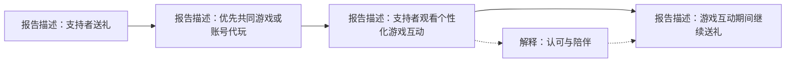

[EN](../../research/KEY_INSIGHTS.md) | [中文](KEY_INSIGHTS.md)

# 核心洞察与潜在启示

[作品集首页](README.md)

[研究过程](RESEARCH_PROCESS.md) · [案例比较](CASE_COMPARISON.md) · [局限与伦理](LIMITATIONS.md) · [证据索引](EVIDENCE_MAP.md)

## 证据与论点标签

本页以私有原始报告为主要来源。**报告中的观察**指报告描述的内容，不代表与原始记录进行过独立核验。**解释**用于说明观察。**假设**是待研究的命题。**潜在启示**是为作品集提出的研究或设计方向，不是已实施的干预或已验证的商业结果。

## 1. 运营能力不足以完整解释两条发展路径

**报告中的观察：** A 结合技术教学、幽默、结构化内容与实际管理，后来仍退出；B 持续发展，其实践包括技术操作、规律在场与个性化支持者关注。[A-01](EVIDENCE_MAP.md#a-01-教学与管理)、[A-02](EVIDENCE_MAP.md#a-02-退场与情境)、[B-01](EVIDENCE_MAP.md#b-01-呈现与内容分发)、[B-02](EVIDENCE_MAP.md#b-02-在场与互动)、[B-03](EVIDENCE_MAP.md#b-03-个性化联系)

**解释：** 报告将 A 的退出归因于游戏变化和个人压力，认为其运营优势不足以抵消这些限制。这一归因不是观察到的因果效应，因此需要同时考察主播与品类的契合。原报告赋予品类首要解释地位，但两个不对称案例不能确定这一优先级，也不能将其与个人处境分离。

**假设：** 养成、自动化或社交要求的变化可能改变主播既有内容的价值。

**潜在启示：** 迁移社群方法前，应研究观众需求与该情境下主播实际可提供的价值。后续比较应主动寻找挑战品类解释的案例，而不只寻找符合论点的案例。

## 2. 可预期的在场与选择性关注可能支持陪伴体验

**报告中的观察：** B 维持规律夜间直播，除感谢礼物外较少回应一般公共聊天。报告还描述了更个性化的支持者联系，包括围绕观看惯例的跟进和会员空间回应。[B-02](EVIDENCE_MAP.md#b-02-在场与互动)、[B-03](EVIDENCE_MAP.md#b-03-个性化联系)

**解释：** 研究者将可预期的在场和较少打扰理解为陪伴体验，并伴随选择性的个人认可。公共聊天回应少，不必然意味着感知价值低。但报告未记录观众访谈，公开观察本身无法验证习惯或期待。

**假设：** 部分观众可能比起频繁公开回应更重视可靠在场，另一些观众则可能将选择性关注体验为排斥。

**潜在启示：** 优化聊天量之前，应研究安静观看者与活跃支持者各自如何定义有价值的直播。任何排期建议都应考虑主播工作负荷与边界；本研究不支持延长工时或全天候在场的建议。

**其他可能解释：** 表面规律性可能受观察者观看时段影响；少回应聊天也可能出于工作负荷或偏好，而非刻意的陪伴策略。私域联系的来源仍待澄清。

## 3. 房管身份在两个社群中具有不同含义

**报告中的观察：** A 的房管工作涉及维持秩序与处理问题。B 中，报告将房管描述为与参与及付费相关的认可；部分持有者自愿维护氛围、引导新人，其他人的相关意愿较弱。[A-01](EVIDENCE_MAP.md#a-01-教学与管理)、[B-05](EVIDENCE_MAP.md#b-05-身份与自愿维护)

**解释：** 同一角色名称可以代表实际责任、认可，或二者兼有。报告将 B 中部分成员的行为解释为主人翁行为，但身份没有产生一致反应。

**假设：** 认可可能鼓励部分人自愿贡献；也可能是原本就愿意贡献的人更容易获得身份。报告不能区分选择效应与身份影响。

**潜在启示：** 明确角色意味着认可、权限还是工作期待。在依赖自愿劳动之前，研究角色持有者自身的期待。这些是拟议的保护措施和问题，不是研究中测试过的改变。

## 4. 个性化游戏互动连接了付费与认可

**报告中的观察：** 报告描述高付费支持者优先获得共同游戏或账号代玩，有时安排在其观看期间；也描述了支持者边观看这些游戏互动边继续送礼、提前联系，以及赛季转换节点安排。报告记述了较高的可见会员等级与礼物榜信号。[B-04](EVIDENCE_MAP.md#b-04-打赏与个性化游戏互动)、[B-06](EVIDENCE_MAP.md#b-06-付费与资料代理信号)

**解释：** 作者将可见付费信号解读为投入较深的付费核心，并认为个性化游戏互动使认可与接近主播的机会变得可见。报告通过准社会关系与交换视角，解释打赏和关注之间可能存在的强化关系。这不能确定各支持者动机、因果方向或收入效果。

实线概括报告中的顺序与共同发生情况，不代表因果效应或经过核实的交易轨迹；虚线表示作者对继续送礼所提出的解释，不是测量过的强化效果。图示不构成共享账号或刺激消费的建议。

**假设：** 接近机会与认可可能解释部分超出技术崇拜的打赏，但娱乐、既有关系、可见性及其他动机仍可能存在。

**潜在启示：** 研究支持者如何理解自己获得的价值，以及非付费观众如何体验同一体系。未来服务设想应明确接近机会与消费边界；判断成效需考察参与者价值及潜在伤害，不能仅看礼物量。

**边界：** 报告非正式对照了技术更强、但可见深度付费支持者似乎较少的其他主播。这是情境观察，不是证明情感比技术更重要的系统性基准比较。

## 5. 角色选择与付费信号用于形成假设

**报告中的观察：** B 集中使用少数操作要求高、观赏性强的游戏角色。报告还描述了高会员等级、礼物榜，以及用于推断观众的资料和自填年龄信号。[B-06](EVIDENCE_MAP.md#b-06-付费与资料代理信号)、[B-07](EVIDENCE_MAP.md#b-07-角色选择)

**解释：** 报告提出角色选择可能连接操作观赏性与个性化游戏互动需求，从而吸引具有特定兴趣的观众。推测中以年轻女性为主的付费群体并未核实。关于更广泛的位置消费模式和发行方经济逻辑的主张，也未被这些案例确立。

**假设：** 角色与玩法偏好可能帮助理解观众想从主播处获得什么，但人口统计标签不能替代需求研究。

**潜在启示：** 通过自愿参与者叙述探索偏好与期待体验，不以头像审美、账号位置或推测性别年龄来定向刺激消费。本研究未建立经验证的用户分群模型。

## 相反例证与校准

作者主动质疑 B 的情绪呈现是否全部出于设计，普通个人特质也可能解释它。报告仅描述部分房管承担维护工作，也仅记录一次核心支持者面对能力质疑仍较稳定的情况。这些限定很关键：不能据此证明算计式意图、身份的普遍效果或情感关系通常更有韧性。[B-01](EVIDENCE_MAP.md#b-01-呈现与内容分发)、[B-05](EVIDENCE_MAP.md#b-05-身份与自愿维护)、[B-08](EVIDENCE_MAP.md#b-08-对能力质疑的回应)

## 研究成果与后续决策

研究产出是质性比较和有边界的解释。未记录产品改变、商业提升、核实后的留存指标或后续评估。下一步应先澄清既有证据来源，再通过参与者视角及可比观察挑战这些假设。[后续研究与待确认问题](LIMITATIONS.md#拟议后续研究)
