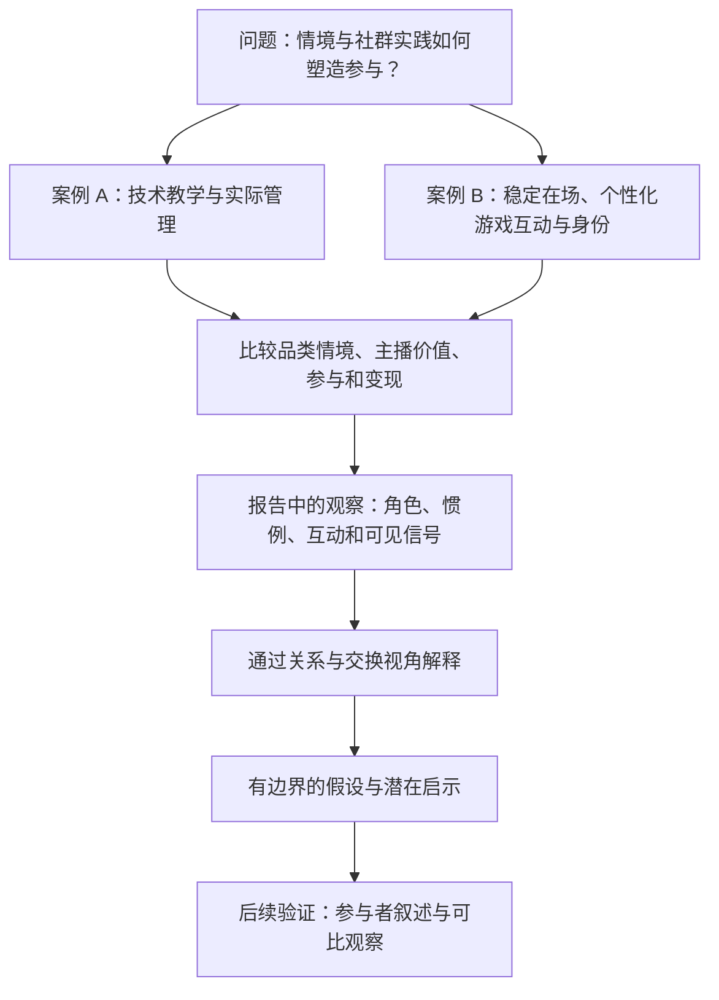

[EN](../../research/RESEARCH_PROCESS.md) | [中文](RESEARCH_PROCESS.md)

# 研究过程

[作品集首页](README.md)

[案例比较](CASE_COMPARISON.md) · [核心洞察](KEY_INSIGHTS.md) · [局限与伦理](LIMITATIONS.md) · [证据索引](EVIDENCE_MAP.md)

## 研究背景与目的

研究源于两位主播的不同发展路径：A 在开放世界／MMO 手游中退出直播，B 则在全民级 MOBA 手游中持续发展成熟社群。我在两个社群中的不同位置，使我能够接触不同层面的运作。来源将其明确标为独立探索性研究。

报告探讨：主播结果能否仅由运营能力解释，还是游戏品类塑造了观众期待、价值展示方式和变现可能性？原报告将品类置于首要解释位置。本作品集保留这一论点，但将其呈现为作者的解释性主张，而非已证明的因果结果。

## 研究问题

**保留自初始 README 的问题：** 游戏品类、主播实践与社群动态如何影响观众的互动与参与？

以下问题用于向作品集读者组织报告已有分析，不声称它们是田野研究前制定的访谈提纲或研究方案。

- 两位主播如何通过教学、操作、在场和个性化互动展示价值？
- 房管身份在各社群中意味着什么？成员如何回应这一身份？
- B 的互动中，打赏、关注和共同游戏如何联系起来？
- 哪些差异可能由情境解释？哪些结论受限于访问程度和间接信号？

## 个人贡献与研究者位置

| 案例 | 报告描述的实际参与 | 研究访问与限制 |
| --- | --- | --- |
| A | 在观众快速增长时担任房管、维持秩序，并参与内容选题讨论 | 直接经历管理、标准化回应和内容讨论；深度参与可能影响对主播退场的解释 |
| B | 长期观察，初期浅度参与，后期获得房管身份 | 观察呈现、内容、礼物信号与角色；运营层面的访问弱于 A，且房管角色本身含义不同 |

案例选择源于这些不同的关系与访问位置。开始关注 B 时，其已处于成熟阶段；A 的叙述则涉及增长与退出。这是基于访问条件的比较，不是匹配招募或控制比较。[CTX-01](EVIDENCE_MAP.md#ctx-01-研究者位置)

## 实际描述的方法

| 方法 | 在报告中的应用 | 证据边界 |
| --- | --- | --- |
| 参与式观察 | 社群参与、房管经历及对主播与观众互动的观察 | 已有报告，但未提供观察日期、频率和底层记录 |
| 双案例比较 | 对照主播价值、内容、角色、会员体系和品类情境 | 案例在成熟度、品类、访问程度上均不同，不能隔离单一原因 |
| 可观察代理指标推断 | 利用礼物榜、可见会员等级、资料线索、自填年龄、位置显示和观看惯例推测观众特征 | 这些是间接且可能误导的信号，不是核实后的人口统计、交易记录或代表性抽样 |
| 理论辅助解释 | 用准社会关系与社会交换视角组织对关注、陪伴、认可和打赏的解释 | 原报告明确提示缺少可引用的一手文献；理论本身不独立验证这些解释 |

报告未记录访谈、正式招募、观众参与者人数、正式编码程序、饱和度评估或实验测试，因此本案例未添加这些方法。

## 本次分析呈现方式

报告依次讨论研究者位置、理论视角、两个案例、比较与局限。在 B 的分析中，作者将惯例、选择性关注、个性化游戏互动和身份与情感价值及打赏联系起来。报告也考虑了呈现可能源于普通个人特质，而非全部出于策略，并指出相同房管身份下存在不同反应。

本次作品集将观察转述并关联至[证据编号](EVIDENCE_MAP.md)。编号是在改写阶段建立的，不是原始田野笔记编号，也不证明曾采用正式编码。解释、假设与潜在启示分别标注。

## 研究框架

下图用于组织报告的分析，不代表经过核实的研究执行顺序。箭头组织比较，不证明因果关系。后续验证为拟议工作，尚未完成。

## 代理推断与校准

报告通过资料线索、自填年龄、礼物榜及周边运营内容，推测付费观众可能以年轻女性为主。作品集将其保留为**未经验证的推断**。头像、账号呈现和位置显示不能确认性别、年龄、收入、居住地或动机。其他运营博主或心理分析内容也不构成对这两个案例的独立验证。

同样，稳定直播安排支持对规律性在场的描述，不等于测量了习惯形成或留存效果。个性化跟进以报告描述的实践呈现；其来源仍需澄清，因为公开观察与私域互动可能涉及不同访问和同意条件。

## 仍需补充的记录

- **TODO：** 确认观察时段、时长、频率及两个案例的覆盖分布。
- **TODO：** 说明哪些内容当时记录、哪些为事后回忆，包括私域联系描述的来源。
- **TODO：** 说明比较与解释实际如何形成和核对，不追溯性地套用正式编码方法。
- **TODO：** 补充支持理论框架的一手文献，并在不公开识别细节的前提下核实相关游戏政策与自动化时间线。

关于同意、发布问题与拟议后续研究，详见[局限与伦理](LIMITATIONS.md)。
