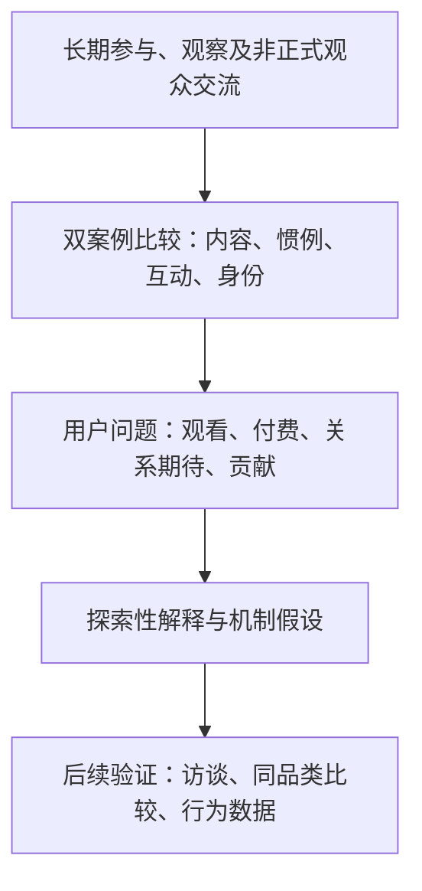

[English](../../research/RESEARCH_PROCESS.md) | **简体中文**

# 研究过程与方法

[首页](README.md) · [案例比较](CASE_COMPARISON.md) · [核心洞察](KEY_INSIGHTS.md) · [证据索引](EVIDENCE_MAP.md)

## 研究如何开始

我先后参与和观察了两个游戏直播社群，注意到它们在内容组织、开播习惯、观众互动、付费体验及发展轨迹上存在明显差异。这些经历促使我比较两种直播模式，并进一步探索观众的参与方式与价值需求。

研究采用**探索性质性研究（Exploratory Qualitative Research）**视角，重点不在于评判主播优劣，而是理解**观众为什么观看、参与、付费和留下，以及主播的运营实践如何回应这些需求**。

## 研究问题

1. 观众在技术学习、操作观赏、音乐和陪伴等观看情境中寻求什么？
2. 游戏服务、专属关注和身份认可如何构成用户感知到的付费价值？
3. 主播公开的关系状态与自我呈现如何影响观众的关系期待？
4. 游戏品类、角色选择与内容形式可能吸引哪些不同的用户需求？
5. 房管等社群身份如何连接荣誉、权限、管理劳动与自愿贡献？

## 研究者位置与材料来源

| 来源 | 实际接触方式 | 研究价值 |
| --- | --- | --- |
| 案例 A | 在增长阶段担任房管，实际参与秩序维护、问题回应及内容选题讨论 | 了解技术型内容与快速增长社群中的实际运营需求 |
| 案例 B | 长期观看与参与，观察直播、短内容、公开身份与礼物信号；后期获得房管身份 | 了解规律陪伴、个性化互动及身份认可的可见表现 |
| 非正式观众交流 | 在日常聊天和其他社交平台，与具有相关观看经历的观众交流 | 补充观看体验和观众视角；不是正式招募的访谈样本 |
| 原始分析报告 | 将长期经历与观察组织为双案例叙述 | 为当前作品集提供主要的回顾性分析材料 |

两个案例的观察位置不对称：A 涉及实际管理和增长阶段，B 主要涉及较成熟的社群及长期观看。比较时保留这种差异，而不是假装两边采用了完全一致的观察条件。

## 分析方式

我从内容、直播惯例、互动方式、付费相关行为、自我呈现和社群身份六个方面整理两个案例，再从用户角度提出观看动机、价值感知、关系期待与主动贡献等解释。

分析中区分三种层次：

- **观察与亲身经历：** 例如参与房管工作、看到直播内容安排、音乐助眠定位或特定互动。
- **解释：** 例如安静观看可能体现陪伴需求，单身形象可能影响部分观众的关系期待。
- **待检验假设：** 例如游戏角色偏好可能吸引具有特定付费体验需求的观众。

[证据索引](EVIDENCE_MAP.md)将研究观察与相应分析主题关联起来。准社会关系、社会交换与自我呈现等概念帮助理解直播间的观看、互动与社群关系。

## 研究框架

## 研究资料与公开方式

公开版本以匿名化转述呈现，不展示主播账号、粉丝身份或私人交流原文。礼物榜、会员等级和账号资料可作为可见行为线索，但不等于经核实的收入、年龄、性别或消费能力。

本研究的样本与证据边界集中说明于[局限与伦理](LIMITATIONS.md)，五个主要发现详见[核心洞察](KEY_INSIGHTS.md)。
