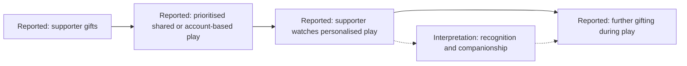

[EN](KEY_INSIGHTS.md) | [中文](../docs/zh/KEY_INSIGHTS.md)

# Key insights and potential implications

[Portfolio home](../README.md)

[Research process](RESEARCH_PROCESS.md) · [Case comparison](CASE_COMPARISON.md) · [Limitations and ethics](LIMITATIONS.md) · [Evidence map](EVIDENCE_MAP.md)

## Evidence and claim labels

This synthesis uses the private original report as its primary source. **Reported observation** means something described there, not independently checked against raw records. **Interpretation** is an explanation of those observations. **Hypothesis** is a proposition to investigate. **Potential implication** is a proposed research or design direction developed for this portfolio, not an implemented intervention or validated business result.

## 1. Operational competence did not fully explain the different trajectories

**Reported observation:** A combined technical teaching, humour, structured content and hands-on moderation, yet later withdrew. B continued with skilled play, regular availability and personalised supporter attention. [A-01](EVIDENCE_MAP.md#a-01-teaching-and-moderation), [A-02](EVIDENCE_MAP.md#a-02-withdrawal-and-context), [B-01](EVIDENCE_MAP.md#b-01-presentation-and-distribution), [B-02](EVIDENCE_MAP.md#b-02-availability-and-interaction), [B-03](EVIDENCE_MAP.md#b-03-personalised-contact)

**Interpretation:** the report attributes A's withdrawal to changes in the game and personal pressures, reading A's operational strengths as insufficient to offset those constraints. This attribution is not an observed causal effect. This supports examining creator–category fit alongside operational practice. The original report gives category a primary explanatory role; two unequal cases cannot determine that priority or separate it from individual circumstances.

**Hypothesis:** changes to progression, automation or social demands may alter the value of a creator's existing offer.

**Potential implication:** before transferring a community tactic, research audience needs and the value a creator can realistically provide in that setting. A comparative follow-up should seek cases that challenge the category explanation as well as those that fit it.

## 2. Predictability and selective attention may support companionship

**Reported observation:** B broadcast on a regular overnight schedule and responded little to general public chat beyond gift acknowledgements. The report describes more personalised supporter contact, including follow-up around viewing routines and responses in member spaces. [B-02](EVIDENCE_MAP.md#b-02-availability-and-interaction), [B-03](EVIDENCE_MAP.md#b-03-personalised-contact)

**Interpretation:** the researcher reads predictable presence and limited interruption as a companionship-oriented experience, with selective personal recognition. Low public-chat responsiveness need not mean low perceived value. However, the report does not document viewer interviews, and public observation alone cannot verify their habits or expectations.

**Hypothesis:** some viewers may value reliable presence more than frequent public responses; others may experience selective attention as exclusion.

**Potential implication:** investigate how quieter viewers and active supporters each define a valuable session before optimising for chat volume. Any scheduling proposal should consider creator workload and boundaries; there is no evidence here for recommending longer hours or round-the-clock availability.

**Alternative explanations:** apparent regularity may reflect the observer's viewing window; limited chat responses may reflect workload or preference rather than a deliberate companionship strategy. Private-contact provenance remains a clarification point.

## 3. Moderator status carried different meanings

**Reported observation:** in A, moderation involved maintaining order and managing questions. In B, the report describes moderator status as recognition associated with involvement and spending. Some holders took on voluntary maintenance and newcomer guidance; others showed less inclination to do so. [A-01](EVIDENCE_MAP.md#a-01-teaching-and-moderation), [B-05](EVIDENCE_MAP.md#b-05-status-and-voluntary-maintenance)

**Interpretation:** the same role label can represent a practical responsibility, recognition or both. The report interprets some B members' actions as ownership behaviour, but status did not produce a uniform response.

**Hypothesis:** recognition may encourage voluntary contribution for some people. Alternatively, people already inclined to contribute may be more likely to obtain the status; the report cannot separate selection from influence.

**Potential implication:** clarify whether a role confers recognition, permissions or work expectations. Research role holders' own expectations before relying on their voluntary labour. These are proposed safeguards and questions, not changes tested in the study.

## 4. Personalised play connected payment with recognition

**Reported observation:** the report describes higher-spending supporters receiving priority for shared play or play on their accounts, sometimes while they watched. It also describes supporters continuing to gift while watching that play, advance supporter contact and attention to season transitions. The account notes high displayed membership levels and gift-ranking signals. [B-04](EVIDENCE_MAP.md#b-04-gifting-and-personalised-play), [B-06](EVIDENCE_MAP.md#b-06-payment-and-profile-proxies)

**Interpretation:** the author reads the visible payment signals as a committed paying core, and personalised play as making recognition and access visible. The report reads a reinforcing relationship between gifting and attention through parasocial and exchange lenses. That does not establish each supporter's motives, the causal direction or a revenue effect.

Solid arrows summarise the reported sequence and co-occurrence, not a causal effect or a verified transaction trail. Dashed arrows show the author's proposed explanation for further gifting, not a measured reinforcement effect. The diagram does not recommend account sharing or spending incentives.

**Hypothesis:** access and recognition may explain some gifting beyond admiration for technical skill. Enjoyment, existing relationships, visibility and other motives remain possible.

**Potential implication:** investigate what supporters understand they receive and how non-paying viewers experience the same system. Any future service concept should make access expectations and spending boundaries clear; success would require evidence of participant value and potential harm, not gift volume alone.

**Qualification:** the report informally contrasts B with more technically accomplished creators who appeared to have fewer visibly committed payers. This is contextual observation, not a systematic benchmark demonstrating that emotion matters more than skill.

## 5. Character choice and payment signals are hypothesis generators

**Reported observation:** B focused on a narrow set of technically demanding, visually engaging characters. The report also describes high membership levels and gift rankings, plus profile and self-entered age signals used for audience inference. [B-06](EVIDENCE_MAP.md#b-06-payment-and-profile-proxies), [B-07](EVIDENCE_MAP.md#b-07-character-choice)

**Interpretation:** the report proposes that character choice may connect the appeal of skilled play with demand for personalised play, effectively attracting an audience with particular interests. Its proposed segment of predominantly younger female paying viewers is inferred, not verified. Claims about wider role-based purchasing patterns and publisher economics are not established by these cases.

**Hypothesis:** character and play-style preferences may help explain what viewers seek from a creator, but demographic labels are not a reliable substitute for researching those needs.

**Potential implication:** explore preferences and desired experiences through voluntary participant accounts. Do not use avatar aesthetics, account location or inferred gender or age to target spending. No validated segmentation model is claimed.

## Counterexamples and calibration

The author explicitly questioned whether B's emotional presentation was wholly designed; ordinary personal traits may also explain it. The report describes only some moderators taking on maintenance work, and notes a single episode in which core supporters appeared resilient to criticism of ability. These qualifications matter: the report does not establish calculated intent, universal status effects or a generally more resilient emotional relationship. [B-01](EVIDENCE_MAP.md#b-01-presentation-and-distribution), [B-05](EVIDENCE_MAP.md#b-05-status-and-voluntary-maintenance), [B-08](EVIDENCE_MAP.md#b-08-response-to-criticism)

## Outcome and next research decisions

The output is a qualitative comparison and a set of bounded explanations. No product change, commercial uplift, verified retention measure or subsequent evaluation is documented. The next useful step is to clarify existing evidence provenance, then seek participant perspectives and comparable observation to challenge the hypotheses. [Future research and unresolved questions](LIMITATIONS.md#proposed-future-research)
