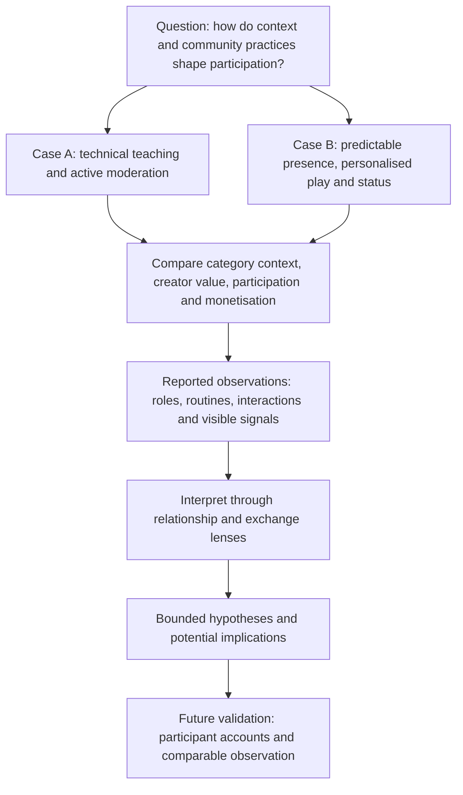

[EN](RESEARCH_PROCESS.md) | [中文](../docs/zh/RESEARCH_PROCESS.md)

# Research process

[Portfolio home](../README.md)

[Case comparison](CASE_COMPARISON.md) · [Key insights](KEY_INSIGHTS.md) · [Limitations and ethics](LIMITATIONS.md) · [Evidence map](EVIDENCE_MAP.md)

## Background and purpose

The study began with two creators whose trajectories differed: A withdrew from livestreaming in an open-world / MMO mobile game, while B continued and developed an established community in a mass-market MOBA mobile game. My different positions in the communities provided access to different aspects of their operation. The source identifies this as independent exploratory research.

The report asks whether creator outcomes can be explained through operational skill alone, or whether the gaming category shapes audience expectations, ways of demonstrating value and monetisation possibilities. Its central claim gives category a primary role. In this portfolio, that claim is retained as the author's explanatory argument, rather than treated as a demonstrated causal result.

## Research questions

**Question retained from the initial README:** How do gaming categories, creator practices and community dynamics shape audience engagement and participation?

The following questions organise the report's existing analysis for portfolio readers. They are not claimed to be a pre-fieldwork interview guide or research protocol.

- How did the two creators demonstrate value through teaching, performance, presence and personalised interaction?
- What did being a moderator mean in each community, and how did members respond to that status?
- How were gifting, attention and shared play connected in B's reported interactions?
- What might contextual differences explain, and where do limited access and indirect signals prevent a firm conclusion?

## My contribution and researcher position

| Case | Actual involvement described in the report | Research access and limits |
| --- | --- | --- |
| A | Moderator responsible for maintaining order during rapid audience growth; contributed to discussions about content topics | First-hand experience of moderation, standard responses and content planning; close involvement may influence interpretation of the creator's exit |
| B | Long-term observer, initially a light participant; later became a moderator | Observed presentation, content, gifting signals and community roles; less operational access than in A, and the moderator role itself differed |

The cases were chosen because of these different relationships and access positions. B was already established when observation began, whereas the account of A includes growth and withdrawal. This is an access-based comparison, not matched recruitment or a controlled comparison. [CTX-01](EVIDENCE_MAP.md#ctx-01-researcher-position)

## Methods actually described

| Method | Application in the report | Evidence boundary |
| --- | --- | --- |
| Participant observation | Community involvement, moderation and observation of creator–audience interactions | The report is available; observation dates, frequency and underlying records are not supplied |
| Comparative case analysis | Comparison of creator value, content, roles, membership systems and category context | Cases differ in maturity, genre and access; differences cannot isolate any single cause |
| Observable proxy inference | Gift rankings, displayed membership levels, profile cues, self-entered ages, location signals and viewing routines were used to infer possible audience characteristics | These are indirect and potentially misleading signals, not verified demographics, transactions or representative sampling |
| Theory-informed interpretation | Parasocial relationship and social exchange lenses organise explanations of attention, companionship, recognition and gifting | The source flags missing primary literature citations; theory does not independently validate the interpretation |

No interviews, formal recruitment, audience participant counts, formal coding procedure, saturation assessment or experimental testing are documented. They have not been added to this case study.

## How the analysis is represented

The report moves from researcher position and theoretical lenses to two case accounts, a comparison and limitations. Within B it connects routines, selective attention, personalised play and status with an explanation of emotional value and gifting. It also considers whether presentation might reflect ordinary personal traits rather than deliberate strategy, and notes different responses to the same moderator role.

For the portfolio, observations have been paraphrased and linked through [evidence IDs](EVIDENCE_MAP.md). These IDs were created during adaptation; they are not original field-note identifiers or proof of a formal coding process. Interpretations, hypotheses and potential implications are labelled separately.

## Research framework

This diagram organises the report's analysis; it is not a verified chronological protocol. Arrows organise the comparison and do not establish causality. Future validation is proposed, not completed.

## Proxy inference and calibration

The report tentatively infers a paying audience made up mainly of younger women from profiles, self-entered ages, gift rankings and surrounding creator commentary. The portfolio retains this as an **unverified inference**. Avatars, account presentation and visible locations cannot confirm gender, age, income, residence or motivations. Commentary from other creators or psychology content does not constitute independent validation of these cases.

Similarly, the report's account of stable scheduling supports a description of regular availability, not a measured habit-formation or retention effect. Descriptions of personal follow-up are retained as reported practices; their provenance requires clarification because public observations and private interactions may have different access and consent conditions.

## Documentation still required

- **TODO:** Confirm the observation period, duration, frequency and distribution across cases.
- **TODO:** Explain what was recorded contemporaneously and what was reconstructed retrospectively, including the source of private-contact descriptions.
- **TODO:** Explain how comparisons and interpretations were developed and checked; do not retrofit a formal coding method.
- **TODO:** Identify primary literature supporting the theoretical framing, and verify relevant game-policy or automation chronology without publishing identifying details.

See [limitations and ethics](LIMITATIONS.md) for consent, publication questions and proposed future research.
