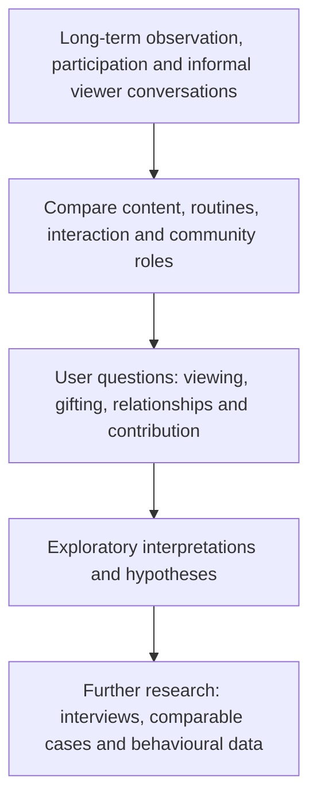

[**English**](RESEARCH_PROCESS.md) | [简体中文](../docs/zh/RESEARCH_PROCESS.md)

# Research Process and Methods

[Home](../README.md) · [Case comparison](CASE_COMPARISON.md) · [Key insights](KEY_INSIGHTS.md) · [Evidence map](EVIDENCE_MAP.md)

## Research origins

I became interested in these two gaming livestream communities through long-term viewing and participation. Their differences in content planning, streaming routines, audience interaction, gifting experiences and trajectories prompted a comparative investigation.

This **exploratory qualitative study** considers how creator practices relate to audience needs, viewing habits, perceived value and community relationships.

## Research questions

1. What do viewers seek from technical learning, skilled gameplay, music and companionship?
2. How might gaming services, personalised attention and recognition contribute to the perceived value of virtual gifts?
3. How do creators' publicly presented relationship status and persona shape audience expectations?
4. What audience needs might different game categories, character choices and content formats attract?
5. How do moderator roles combine status, permissions, practical responsibilities and voluntary contribution?

## Researcher position and materials

| Dimension | Case A: open-world MMO | Case B: MOBA |
| --- | --- | --- |
| Stage observed | Rapid audience growth, followed by withdrawal | Primarily an established community |
| Involvement | Served as a chat moderator, maintaining order, responding to questions and discussing content topics | Long-term viewing and participation; observed streams and public content; later received moderator status |
| Materials observed | Tutorials, stream operations, viewer questions and hands-on chat moderation | Consistent streaming, music-led companionship, personalised interactions, public persona, gifting and community status |
| Research perspective | Direct experience of managing a growing, technical-content community | Longitudinal perspective on viewing, relationships and community recognition |

Informal conversations with viewers through everyday interactions and other social platforms offered additional perspectives on the viewing experience. My observations and experiences were also organised into an original two-case analytical report, which informs this study.

The cases offer different forms of access. I was directly involved in A's moderation during growth; B was already relatively established when I began observing it.

## Analytical approach

I organised the cases around six areas: **content, streaming routines, interaction, gifting-related practices, self-presentation and community roles**. I then examined them through the user-centred themes of viewing motivation, perceived value, relationship expectations and voluntary contribution.

The analysis distinguishes between:

- **Observed practices and experiences:** for example, moderation duties, music-led streams and personalised gaming interactions.
- **Interpretations:** for example, quiet listening as a form of companionship or a public single persona as a possible relationship cue.
- **Research hypotheses:** for example, whether particular game characters attract viewers seeking personalised gaming services.

The [evidence map](EVIDENCE_MAP.md) connects observations with the relevant themes. Parasocial relationships, social exchange and self-presentation provide interpretive concepts.

## Research framework

## Public documentation

The portfolio uses anonymised paraphrases rather than identifying accounts, private messages or verbatim viewer conversations. Gift rankings, visible status levels and profile cues are treated as behavioural signals, not verified demographic or financial data.

[Key insights](KEY_INSIGHTS.md) · [Limitations and ethics](LIMITATIONS.md)
